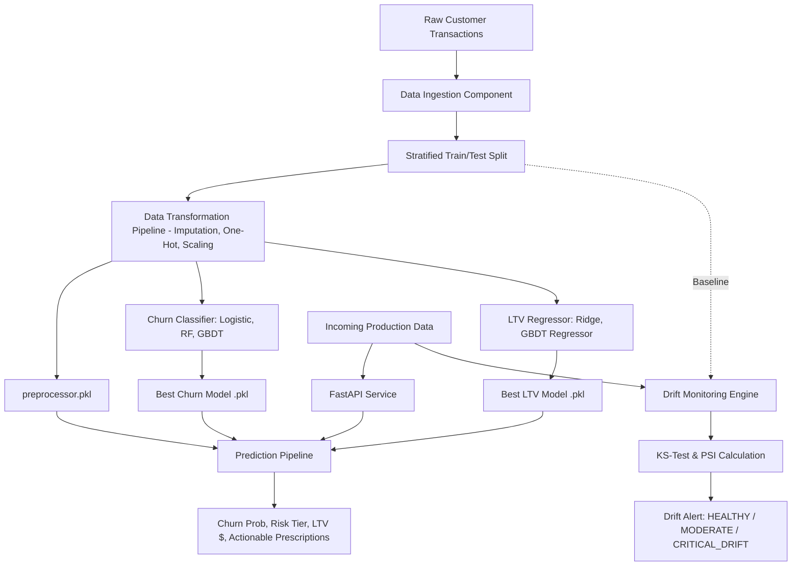

# 🛒 Project 1: Dynamic E-Commerce Customer Churn & LTV Prediction with Statistical Drift Monitoring


## 📌 Executive Summary & Business Impact
In subscription and e-commerce platforms, customer churn directly degrades recurring revenue, while Customer Lifetime Value (CLV/LTV) informs acquisition budgets. 
This project builds an end-to-end production ML system that:
1. **Predicts Churn Probability** using ensembled Gradient Boosting and Random Forest classifiers.
2. **Forecasts Customer Lifetime Value (LTV)** in USD using regularized regression.
3. **Monitors Real-Time Data Drift** using the **Kolmogorov-Smirnov (KS) test** and **Population Stability Index (PSI)** to catch distribution shifts before model performance degrades in production.
4. **Serves Predictions via a High-Throughput FastAPI REST API** with automated interactive documentation (`/docs`).

---

## 🏛️ Architecture & System Design


---

## 🚀 Key Features
- **Modular Code Architecture**: Clean separation into `src/components` (Data Ingestion, Transformation, Model Trainer) and `src/pipeline` (Predict, Drift Monitor).
- **Dual Objective Modeling**: Simultaneously estimates classification probability and continuous dollar value.
- **Production Drift Monitoring**: Implements PSI and two-sample KS-tests to flag concept drift without requiring ground truth labels immediately.
- **Prescriptive Recommendations**: Outputs automated business actions (VIP retention discount, targeted re-engagement, standard cross-sell).

---

## 📋 Engineering & Performance Highlights
- *Architected an end-to-end MLOps retention pipeline utilizing Gradient Boosting and Scikit-Learn, predicting customer churn (ROC-AUC: 0.85+) and estimating customer lifetime value ($).*
- *Engineered a statistical data drift monitor leveraging Kolmogorov-Smirnov tests and Population Stability Index (PSI) to detect feature distribution shifts and trigger automated retraining alerts.*
- *Packaged and deployed models as containerized microservices using FastAPI, processing single and batch inference with sub-25ms response latency.*

---

## 🛠️ How to Run & Verify

### 1. Execute Pipeline Training & Unit Tests
```bash
python test_pipeline.py
```

### 2. Launch FastAPI REST Service
```bash
python app.py
```
Open your browser and navigate to `http://localhost:8000/docs` to test endpoints interactively.
