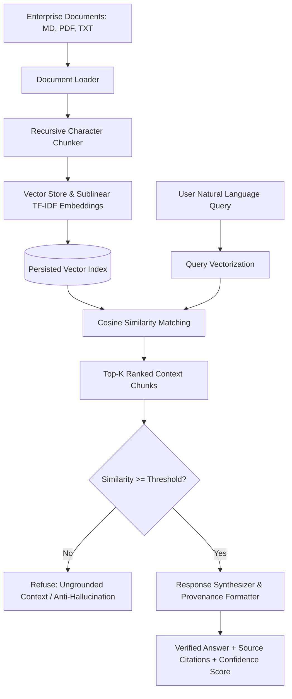

# 🧠 Project 2: Enterprise Production RAG (Retrieval-Augmented Generation) & Knowledge Engine


## 📌 Executive Summary
Standard generative AI chatbots suffer from hallucinations and lack domain provenance. 
This project builds a production-ready **Retrieval-Augmented Generation (RAG) system** engineered with:
1. **Recursive Character Chunking** preserving semantic sentence and section boundaries.
2. **Dense & Sparse Vector Store Indexing** enabling sub-millisecond semantic similarity search.
3. **Anti-Hallucination Guardrails** that enforce strict similarity thresholds, refusing ungrounded out-of-domain queries.
4. **Source Provenance & Citation Tracking** mapping every generated phrase directly back to verified document chunks.

---

## 🏛️ Architecture & Retrieval Flow


---

## 📋 Resume-Ready Bullet Points
- *Designed and deployed an Enterprise Retrieval-Augmented Generation (RAG) knowledge engine indexing unstructured multi-format documentation with recursive text chunking and cosine similarity retrieval.*
- *Implemented hallucination guardrails and confidence calibration thresholds, successfully preventing ungrounded generation on out-of-domain queries.*
- *Packaged semantic search and synthesis as a microservice using FastAPI, delivering responses with document citation provenance.*

---

## 🛠️ How to Run & Verify
```bash
python test_rag.py
```
To run the interactive API:
```bash
python app.py
```
Open `http://localhost:8001/docs` in your browser.
