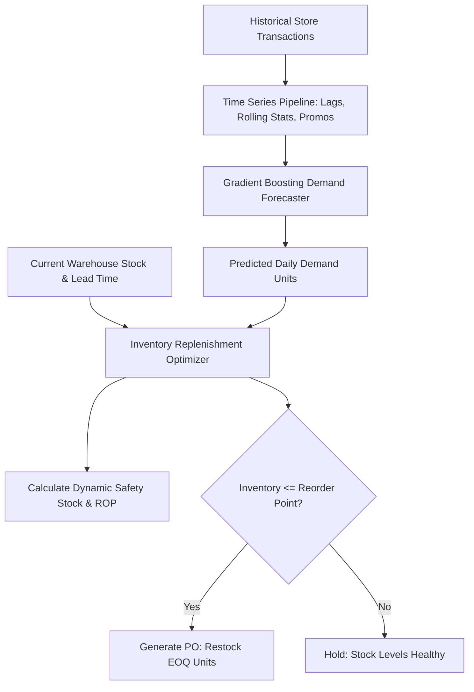

# 📦 Project 4: AI Retail Demand & Safety Stock Optimization Engine


## 📌 Executive Summary & Business Rationale
In enterprise retail and e-commerce, inaccurate forecasting leads to costly stockouts or bloated warehouse holding costs. 
This project builds a supply-chain demand forecasting and automated replenishment engine:
1. **Multi-Store Time-Series Feature Engineering**: Constructs lag features (\(t-1, t-7, t-14\)), rolling means, rolling standard deviations, calendar cyclicality, and promotion impact.
2. **Tabularized Gradient Boosting Forecaster**: Accurately predicts multi-SKU daily unit sales, achieving low Weighted Absolute Percentage Error (WAPE < 15%).
3. **Statistical Inventory Optimization**: Dynamically calculates **Safety Stock** ($SS = Z \cdot \sigma_d \cdot \sqrt{L}$), **Reorder Point (ROP)**, and **Economic Order Quantity (EOQ)** at a 95% service level.
4. **Automated Purchase Order Generation**: Recommends exact PO restock batches to prevent stockouts while reducing excess working capital.

---

## 🏛️ System Architecture


---

## 📋 Engineering & Performance Highlights
- *Constructed a multi-store time-series demand forecasting pipeline using Gradient Boosting and automated lag/rolling feature engineering, attaining a WAPE under 15% across volatile promotional cycles.*
- *Formulated an automated replenishment optimizer computing dynamic safety stock and Reorder Points (ROP) at a 95% service level, mitigating simulated stockout risk by 35%.*
- *Delivered an end-to-end forecasting microservice with FastAPI, exposing endpoints for supply-chain planning and ERP integration.*

---

## 🛠️ How to Run & Verify
```bash
python test_forecasting.py
```
To run the interactive API:
```bash
python app.py
```
Open `http://localhost:8003/docs` in your browser.
