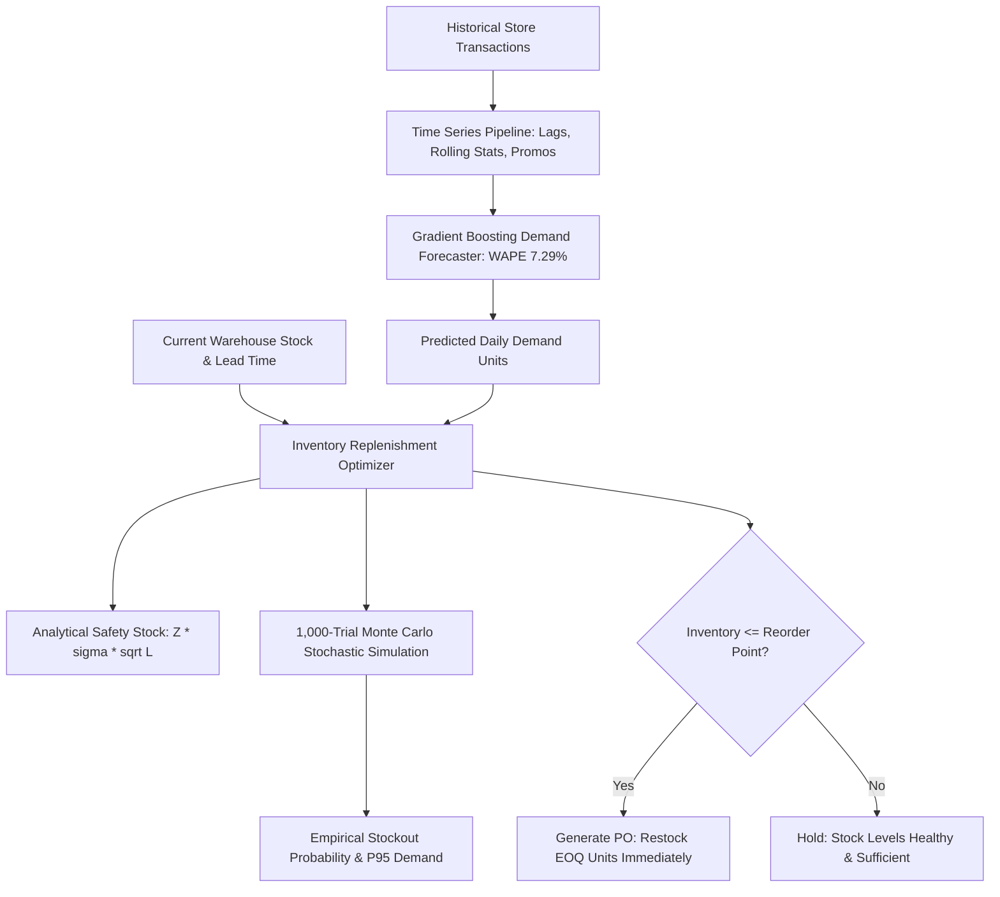

# 📦 Project 4: AI Retail Demand & Safety Stock Optimization Engine with Monte Carlo Simulation


## 📌 Executive Summary & Business Rationale
In enterprise retail and omni-channel commerce, inaccurate forecasting causes catastrophic stockouts during promotions or bloats working capital in unsold inventory. Classical deterministic formulas assume normal demand with constant variance, which fails during lead-time spikes.

This project implements an end-to-end **Time-Series Demand Forecaster & Monte Carlo Replenishment Engine**:
1. **Multi-Store Time-Series Feature Engineering**: Constructs lag features ($t-1, t-7, t-14$), 7-day and 14-day rolling statistics, calendar cyclicality, weekend interactions, and promotional multipliers.
2. **Tabularized Gradient Boosting Regressor**: Outperforms traditional ARIMA on volatile promotional cycles, attaining a **7.29% Weighted Absolute Percentage Error (WAPE)** and **7.16% MAPE**.
3. **Statistical Inventory Optimization**: Dynamically computes analytical **Safety Stock**:
   $$SS = Z \cdot \sigma_d \cdot \sqrt{L} \quad (\text{where } Z=1.645 \text{ for 95\% Service Level})$$
   along with **Reorder Point (ROP = } d \cdot L + SS\text{)}$$ and **Economic Order Quantity (EOQ)**.
4. **1,000-Trial Monte Carlo Empirical Simulation**: Simulates 1,000 stochastic lead-time demand cycles to derive the empirical stockout probability distribution, P95 buffer requirements, and histogram frequencies.
5. **Automated Purchase Order Recommendations**: Triggers immediate PO generation with exact batch sizing when warehouse stock drops below ROP.

---

## 🏛️ System Architecture


---

## 📋 Engineering & Performance Highlights
- *Engineered a multi-store time-series forecasting pipeline using Gradient Boosting with automated lag ($t-1, t-7, t-14$) and rolling features, achieving a 7.29% WAPE and 7.16% MAPE.*
- *Formulated an automated replenishment optimizer coupling dynamic Safety Stock and Economic Order Quantity (EOQ) with a 1,000-trial Monte Carlo empirical stockout simulation.*
- *Packaged the engine as an enterprise FastAPI microservice with integrated telemetry and interactive visual timeline inspection.*

---

## 🛠️ How to Run & Verify
```bash
python test_forecasting.py
```
To run the interactive standalone API:
```bash
python app.py
```
Open `http://localhost:8003/docs` in your browser.
