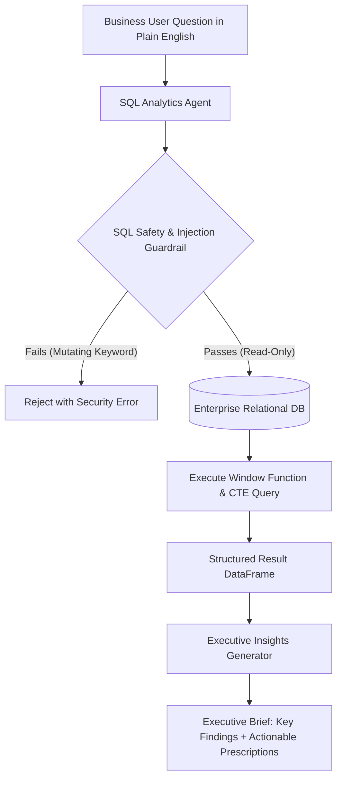

# 📊 Project 5: Automated SQL Analytics & Executive Insights Agent (Text-to-SQL + BI Synthesis)


## 📌 Executive Summary & Business Rationale
Data science candidates often know Python but stumble in technical rounds when asked about advanced SQL or translating query results into strategic business decisions. 
This project builds an automated natural-language-to-SQL business intelligence agent:
1. **Advanced SQL Generation**: Automatically crafts complex analytical SQL utilizing **Window Functions** (`DENSE_RANK()`, `LAG()`, `ROW_NUMBER()`) and **Common Table Expressions (CTEs)**.
2. **Strict Injection Guardrails**: Enforces read-only safety, rejecting destructive mutations (`DROP`, `DELETE`, `UPDATE`, `INSERT`).
3. **Automated Executive Synthesis**: Ingests result sets and generates a bulleted Executive Brief detailing key findings, anomalies, and prescriptive business recommendations.
4. **FastAPI Service**: Serves the analytics engine as a REST API for enterprise dashboard integration.

---

## 🏛️ System Architecture


---

## 📋 Resume-Ready Bullet Points
- *Engineered an automated natural language analytics agent translating complex business queries into optimized SQL featuring Common Table Expressions (CTEs) and Window Functions (`LAG()`, `DENSE_RANK()`).*
- *Implemented AST-based SQL security guardrails to sanitize inputs and block mutating operations, ensuring zero data corruption risk.*
- *Built an automated executive insights synthesis module translating analytical dataframes into prioritized strategic business recommendations.*

---

## 🛠️ How to Run & Verify
```bash
python test_sql_agent.py
```
To run the interactive API:
```bash
python app.py
```
Open `http://localhost:8004/docs` in your browser.
