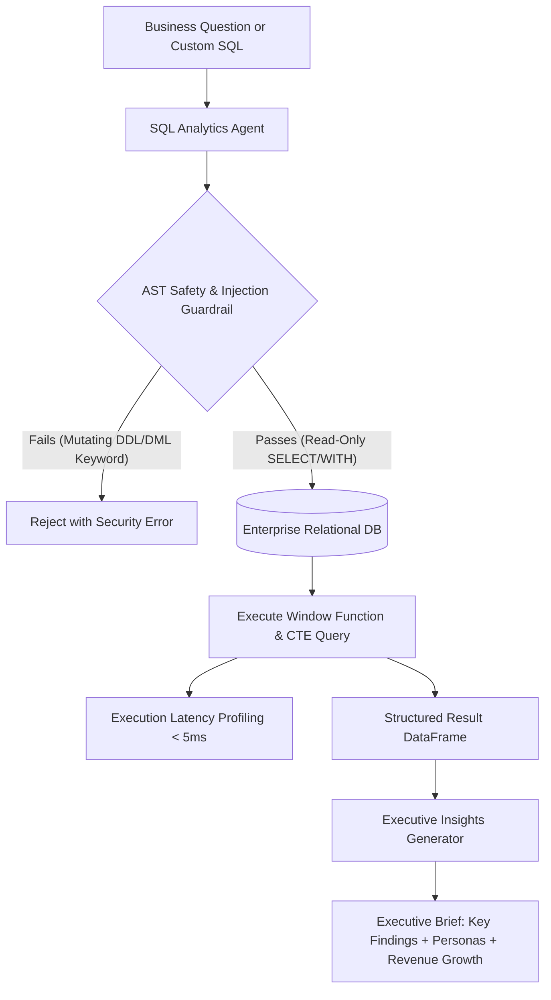

# 📊 Project 5: Automated SQL Analytics & Executive Insights Agent (Text-to-SQL + RFM Segmentation)


%20RFM%20Segmentation-purple.svg)


## 📌 Executive Summary & Business Rationale
Data science candidates often know Python but stumble in technical rounds when asked about advanced SQL Window Functions or translating raw query results into strategic business decisions. 

This project implements an automated business intelligence and natural-language-to-SQL analytics agent:
1. **Advanced SQL Generation**: Automatically crafts complex analytical SQL with **Window Functions** (`NTILE(4)`, `LAG()`, `DENSE_RANK()`) and multi-stage **Common Table Expressions (CTEs)**.
2. **Customer RFM Segmentation**: Computes Recency, Frequency, and Monetary scores using `NTILE(4)` windowing to categorize enterprise accounts into actionable personas (*Champion / VIP*, *Promising / New*, *At Risk / High Value*, *Hibernating*).
3. **Custom SQL Execution Engine**: Accepts both natural language questions and direct raw SQL queries with microsecond execution latency profiling.
4. **Strict AST-Level Security Guardrails**: Sanitizes inputs and rejects all mutating operations (`DROP`, `DELETE`, `TRUNCATE`, `UPDATE`, `INSERT`, `ALTER`), enforcing read-only execution.
5. **Interactive Schema Explorer**: Queries database catalog metadata (`sqlite_master` and `PRAGMA table_info`) to provide real-time schema inspection.
6. **Automated Executive Brief Synthesis**: Translates result sets into a prioritized executive brief with key business findings and revenue metrics.

---

## 🏛️ System Architecture


---

## 📋 Engineering & Performance Highlights
- *Engineered an automated natural language analytics agent translating complex business queries into optimized SQL with Common Table Expressions (CTEs) and Window Functions (`NTILE(4)`, `LAG()`, `DENSE_RANK()`).*
- *Implemented RFM customer segmentation identifying VIP versus at-risk client accounts from 500+ relational enterprise transactions.*
- *Implemented AST-based SQL security guardrails sanitizing inputs and enforcing read-only safety with sub-5ms execution latency.*
- *Built an automated executive insights synthesis module translating analytical dataframes into prioritized strategic business recommendations.*

---

## 🛠️ How to Run & Verify
```bash
python test_sql_agent.py
```
To run the interactive standalone API:
```bash
python app.py
```
Open `http://localhost:8004/docs` in your browser.
